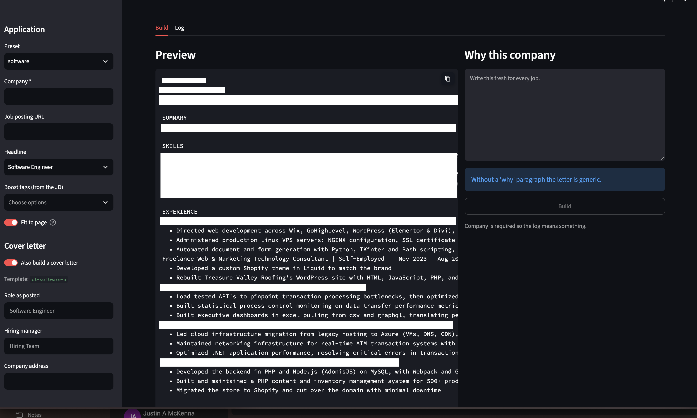

# resume-builder

Builds a tailored, ATS-safe resume (and optionally a matching cover letter) for each job application from one source of truth, `master.yaml`.

You pick a **preset** (devops, software, martech, systems, embedded). The builder selects the matching roles, projects, bullets and skills, renders them into a Word template, converts to PDF with LibreOffice, trims bullets until it fits the page target, and logs what was sent where.

```
master.yaml ──► selector.py ──► template.docx ──► LibreOffice ──► out/<date>_<company>_<preset>/
 (content)      (what to show)   (layout)          (PDF + fit loop)   ..._Resume.pdf / .docx
                      │                                               ..._Cover_Letter.pdf / .docx
                      └──► cover_template.docx  (--cover)             + entry in log.json
```

---

## Setup

1. **Python 3.11+** and the dependencies (a virtual environment keeps them out of your system Python):
   ```
   python3 -m venv .venv
   source .venv/bin/activate        # Windows: .venv\Scripts\activate
   pip install -r requirements.txt
   ```
2. **LibreOffice** (used for DOCX → PDF). Install it in `/Applications`, or set `SOFFICE=/path/to/soffice`.
3. **Fonts** are already in `fonts/`. Headless LibreOffice can't see your Mac's installed fonts, so `build.py` copies everything in `fonts/` into LibreOffice's profile on each run. If a template ever uses a new font, drop the `.ttf` in `fonts/` (see [Troubleshooting](#troubleshooting)).

Check that everything works:
```
python models.py master.yaml     # validates master.yaml, prints counts
pytest -q                        # builds every preset and checks the output (~90s)
```

---

## Start your own resume

`master.yaml` holds one real person's resume. To make your own, start from **`example.yaml`**: a small, fully commented file for a fictional engineer with two tracks (`backend`, `data`), two jobs, a project, skills, education, certs, two cover letters, and two presets. Every field is explained where it appears.

1. **Try the example first** to see what it produces:
   ```
   python models.py example.yaml
   RESUME_MASTER=example.yaml python selector.py backend          # text preview
   RESUME_MASTER=example.yaml python build.py --preset backend --company "Test"
   ```
2. **Copy it over the master file** (back up the existing one if you need it):
   ```
   cp example.yaml master.yaml
   ```
3. **Replace the content, top to bottom:**
   - `profile`: your name and contact details.
   - `headlines`: one key per kind of job you apply for. These keys become your **tracks**, so rename `backend`/`data` here first, then everywhere they're used.
   - `summaries`: one short paragraph per track.
   - `roles` and `projects`: your experience. Give each bullet an `id`, the `tracks` it supports, and a `priority` (1 = must show, 3 = filler).
   - `skills`: point `receipts` at the bullets that prove each skill.
   - `education`, `certs`.
   - `presets`: list the role and project ids each preset should include.
   - `cover_letters`: optional, only needed for `--cover`.
4. **Validate after every few edits:** `python models.py master.yaml`. Errors name the exact problem (unknown track, missing id, bad date).
5. **Preview, then build:** `python selector.py <preset>`, then `python build.py --preset <preset> --company "..."`.
6. **Clear the log:** `log.json` records past applications. Delete it to start fresh; it's recreated on the next build.

To keep several master files side by side, leave `master.yaml` alone and point the tools at another file with `RESUME_MASTER=path/to/file.yaml`. This works for `build.py`, `selector.py` and `app.py`.

---

## Everyday use

### Web UI
```
streamlit run app.py
```



Opens a browser app with the same options as the CLI: pick a preset, enter the company, choose a headline and boost tags, see a live text preview, then click **Build** to get PDF/DOCX downloads. The **Log** tab lists past applications. It reloads `master.yaml` automatically when you save changes.

### Build a resume for an application
```
python build.py --preset devops --company "L3Harris" --url https://jobs.example.com/123
```
Output lands in `out/2026-10-03_l3harris_devops/` with a recruiter-friendly filename, and a log entry is appended to `log.json`.

### Resume + cover letter
```
python build.py --preset devops --company "Acme" --cover \
  --role "Platform Engineer" --manager "Jane Doe" --why-file why_acme.txt
```
The cover letter is written to the same folder as `..._Cover_Letter.pdf`.

### Preview without building
```
python selector.py devops                     # plain-text preview + warnings in the terminal
python selector.py devops --boost terraform,aws
```

### Sanity-check every preset
```
python build.py --all        # builds everything into out/, no log entry
```

### All flags

| Flag | What it does |
|---|---|
| `--preset NAME` | Which preset to build (required unless `--all`) |
| `--company NAME` | Used in the folder name, log, and cover letter (required) |
| `--url URL` | Job posting link, saved in the log |
| `--headline TEXT` | Pick a headline variant to mirror the posting's title. Must already exist under `headlines` in `master.yaml` |
| `--boost tag1,tag2` | Keywords from the job description. Bullets with matching `tags` float up |
| `--no-fit` | Skip the fit-to-page loop |
| `--all` | Build every preset, no log |
| `--cover` | Also build a cover letter |
| `--role TEXT` | Cover: the job title as posted (default: resume headline) |
| `--manager NAME` | Cover: hiring manager (default greeting: "Dear Hiring Team,") |
| `--address TEXT` | Cover: company address line |
| `--why TEXT` / `--why-file PATH` | Cover: the "why this company" paragraph |

**Tip:** the `--why` paragraph is the one recruiters actually read. Write it fresh for every job. Without it the letter is generic and the build warns you.

---

## How selection works

- **Tracks** (`devops`, `software`, `martech`, `systems`, `embedded`) tag every bullet, skill, cert, and coursework entry. A preset shows things whose tracks overlap the preset's `tracks`. The keys under `headlines` *are* the list of valid tracks; a typo'd track fails validation.
- **Priority** on a bullet: `1` = always show, `2` = show if room, `3` = filler (cut first). It can be per track: `priority: { devops: 1, software: 3 }`. A bullet that only matches a *borrowed* track (e.g. an embedded bullet on the software preset) is demoted one step.
- **Order inside a role/project:** priority 1 first, then `--boost` keyword matches, then priority, then YAML order.
- **Fit loop:** the build renders, counts pages, and if it's over `max_pages` drops the least valuable bullet (highest priority number, from the biggest/oldest block) and tries again. It never drops a priority-1 bullet or empties a block, so if it can't reach the target, it ships slightly long and tells you. Anything over **2 pages** fails the tests.
- **Projects** render in the order the preset lists them, so put your strongest one first.

### Cover letters
- The letter is chosen by the preset's headline track (`cl-devops-a` for devops, etc.).
- Each **proof** paragraph lists `refs` (bullet ids). A paragraph is only included if at least one of its bullets made it onto *this* resume, so the letter never claims something the resume left out.
- Always one page. If it runs over, the lowest-priority proof paragraph is cut first; priority 1 is never cut.
- `{company}` and `{role}` in the text get filled in. Any other `{placeholder}` fails validation.

---

## Making changes

Everything content-related happens in **`master.yaml`**. After editing, run `python models.py master.yaml`: it catches typos, unknown tracks, duplicate ids, and references to things that don't exist.

### Add a bullet
Under a role or project:
```yaml
- id: carrier-cache            # unique, lowercase-with-dashes
  tracks: [devops, systems]
  tags: [redis, caching]       # matched by --boost
  priority: { devops: 1, systems: 2 }
  text: "Added a Redis cache in front of the pricing API, cutting p95 latency 40%"
```

### Add a role or project
Add it under `roles:` or `projects:` (needs `id`, dates as `YYYY-MM`, `end: null` for ongoing, at least one bullet), then **add its id to each preset** that should show it. Nothing appears until a preset lists it.

### Add a skill
```yaml
- { name: Redis, category: "Tools & Platforms", tracks: [devops], receipts: [carrier-cache] }
```
`receipts` are bullet or project ids that prove the skill. Empty receipts trigger a warning, and presets with `hide_skills_without_receipts: true` hide that skill.

### Mirror a job posting's title
Add the title to that track's list under `headlines`, then pass `--headline "Exact Title"` (or set `headline_variant` on the preset).

### Add or tune a preset
Copy an existing preset under `presets:` and change:

| Field | Meaning |
|---|---|
| `headline` | Track key used for the title and primary priorities |
| `summary` | A summary id from `summaries:` |
| `tracks` | Tracks this preset pulls content from (first is usually the headline) |
| `sections` | Which sections, in what order |
| `roles`, `projects` | Ids to include (projects render in this order) |
| `max_bullets_per_role` / `_project` | Caps before the fit loop starts |
| `max_pages` | Fit loop target |

If a preset keeps spilling to a second page, the usual levers are: fewer projects, lower bullet caps, or fewer priority-1 bullets (the fit loop can't touch those).

### Add a new track
Add a key under `headlines`, then tag content with it and create a preset. No code changes.

### Write or edit a cover letter
Under `cover_letters:`:
```yaml
- id: cl-embedded-a
  tracks: [embedded]
  opener: "I'm applying for the {role} position at {company}. ..."
  proof:
    - refs: [hil-pipeline, pp-firmware]
      priority: 1
      text: "..."
  closer: "I'd welcome the chance to talk about ... {company} ..."
```
Keep every claim traceable to a bullet in `refs`. Write each proof paragraph so it stands alone, since any of them may be skipped.

### Edit the layout
- `template.docx` (resume) and `cover_template.docx` (letter) are normal Word files with Jinja tags like `{{ headline }}` and ``. Edit them in Word.
- Keep each `{{ tag }}` typed in one go. If Word splits a tag across formatting runs, it won't render.
- Rendering uses strict mode: a misspelled tag crashes the build instead of silently printing nothing.
- `template.backup.docx` is the resume template before the margin/spacing tightening (0.6" → 0.5" sides). Copy it back over `template.docx` to undo.
- Alternate templates: `RESUME_TEMPLATE=other.docx python build.py ...` (also `COVER_TEMPLATE`, `RESUME_MASTER`).

---

## Tests

```
pytest -q                          # everything
pytest -q -k devops                # one preset
pytest -q tests/test_cover.py      # cover letters only
```

`tests/test_ats.py` reads each PDF back the way a cheap ATS would and checks: no more than 2 pages, contact info at the top and extractable, sections in order, every bullet and skill extractable, titles and companies not fused together, no tables, text boxes, images, columns, or header/footer content.

`tests/test_cover.py` checks: one page, no unrendered tags or `{placeholders}`, company/role/why present, every proof paragraph backed by a bullet on the resume, filename matches the resume.

Run the tests after changing the templates, fonts, or anything structural in `master.yaml`.

---

## Files

| Path | What it is |
|---|---|
| `master.yaml` | All content: profile, headlines, cover letters, summaries, roles, projects, skills, education, certs, presets |
| `example.yaml` | Commented starter file to copy when creating your own `master.yaml` |
| `app.py` | Streamlit web UI over the same build pipeline |
| `requirements.txt` | Python dependencies |
| `models.py` | Schema + validation for `master.yaml` |
| `selector.py` | Picks what goes on the page for a preset (resume and cover letter) |
| `build.py` | CLI: render, PDF, fit loop, output folders, log |
| `template.docx` / `cover_template.docx` | Word layouts |
| `fonts/` | Fonts loaded into LibreOffice for every build |
| `out/` | Generated applications, one folder each |
| `log.json` | One entry per application: what was sent, which bullets, files, status |
| `tests/` | ATS and cover letter checks |

---

## Troubleshooting

**Garbled PDF text (`\x03` instead of "e") or resumes suddenly a page longer.** LibreOffice fell back to another font. Make sure every font the template uses is in `fonts/`. To check which fonts a PDF actually used:
```
python -c "from pypdf import PdfReader; p=PdfReader('file.pdf').pages[0]; print({f.get_object()['/BaseFont'] for f in p['/Resources']['/Font'].values()})"
```
Before the fonts fix (Oct 2, 2026), PDFs were built with the fallback font. Rebuild anything older before sending it.

**LibreOffice hangs.** The build uses a throwaway LibreOffice profile so an open LibreOffice window shouldn't block it. If it still hangs, quit LibreOffice and retry.

**`master.yaml integrity check failed`.** The message lists each problem (unknown track, dangling id, duplicate id). Fix and rerun `python models.py master.yaml`.

**`no cover letter for preset`.** That preset's tracks have no entry under `cover_letters`.

**Don't rename `selector.py` to `select.py`.** It would shadow Python's built-in `select` module and break LibreOffice calls.

---

## Open to-dos (for the current `master.yaml`)

- `software` preset uses `sum-devops-a` as a placeholder summary. Write `sum-software-a`.
- Search `master.yaml` for `CONFLICT` and `VERIFY` before sending anything.
- Skills with empty `receipts` (e.g. Kubernetes) show up in builds but nothing on the resume backs them.
# fitted
